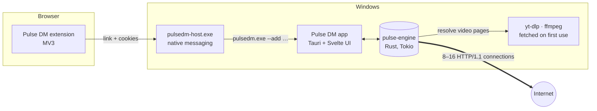

<div align="center">


# Pulse DM

**A fast, free and open-source download manager for Windows.**
Multi-connection downloads that resume, a browser extension, video sites (YouTube & 1000+ more), queues and a scheduler, in a native app smaller than 3 MB.

[](LICENSE)


</div>

> 🇹🇷 **Türkçe:** Pulse DM, Windows için hızlı, ücretsiz ve açık kaynaklı bir indirme yöneticisidir. Dosyaları aynı anda 8–16 bağlantıyla indirir, kopan indirmeleri kaldığı yerden sürdürür, tarayıcı eklentisiyle indirmeleri otomatik yakalar ve YouTube dahil 1000'den fazla video sitesinden indirebilir. Arayüz Türkçedir; motor Rust ile yazılmıştır ve kurulum dosyası 3 MB'tan küçüktür. Geliştirme aşamasındadır.

---

## Contents

- [Highlights](#highlights)
- [Benchmarks](#benchmarks)
- [Features](#features)
- [How it works](#how-it-works)
- [Installation](#installation)
- [Browser extension](#browser-extension)
- [Building from source](#building-from-source)
- [Project structure](#project-structure)
- [Where Pulse DM keeps its files](#where-pulse-dm-keeps-its-files)
- [Roadmap](#roadmap)
- [Responsible use](#responsible-use)
- [Contributing](#contributing)
- [License and credits](#license-and-credits)

## Highlights

- **Fast:** every file is split across many connections, and idle connections take over half of the slowest one's remaining range, so all of them finish together.
- **Adapts to the server by itself:** starts with 8 connections and adds more (up to 16) only while it measurably speeds things up. When a server refuses extra connections (HTTP 503/429), Pulse quietly drops back instead of failing or getting your IP blocked.
- **Light:** about **3 MB of RAM** while waiting in the tray, and a **2.7 MB** installer.
- **Never loses progress:** pause, close the app, reboot or lose the network, and the download continues from where it stopped. Expired links can be replaced and the download keeps its progress.
- **Video sites:** YouTube, X/Twitter, Instagram, TikTok, Vimeo, Twitch, Reddit and 1000+ more, in any quality up to 8K, or audio only as MP3.
- **Works like IDM in the browser:** a "Download with Pulse DM" button appears on videos, and regular downloads are captured with your cookies so files behind a login work too.

## Benchmarks

Same 1 GB test file ([Tele2 speed test server](http://speedtest.tele2.net/)), same machine and network, runs interleaved (Pulse → AB → Pulse → AB), October 2026. RAM is the **private memory of the whole process tree** (working-set totals double-count memory that WebView2 processes share).

| | Avg. time | Avg. speed | Peak RAM while downloading | RAM idle in tray |
|---|---:|---:|---:|---:|
| **Pulse DM 0.1** | **29.0 s** | **35.4 MB/s** | **186 MB** | **3 MB** |
| AB Download Manager 1.11.1 | 40.9 s | 25.6 MB/s | 473 MB | 400 MB |

YouTube, 720p video (153 MB), video and audio merged into MP4: **5.7 s (≈57 MB/s)**. The same stream downloaded as one plain request is throttled by YouTube to about 3.6 MB/s.

> **Take benchmarks with a grain of salt.** This test server limits each connection to about 2.7 MB/s, which is the situation where a download manager helps most; the gap is smaller on servers without such a limit. Results are from two runs on one network, and speeds varied between runs. Measure on your own connection (the `bench` example below times the engine alone), and open an issue if you see different results.

## Features

### Download engine

- Segmented HTTP(S) downloads, with each segment on its own TCP connection (HTTP/1.1 on purpose: HTTP/2 would squeeze every segment into one connection).
- Dynamic work stealing between connections, so the last few percent never crawl on a single connection.
- **Automatic connection count**: 8 → 12 → 16 while each step adds at least 8 % speed; it freezes as soon as the server pushes back.
- Writes straight into the final file (sparse on NTFS), so there is no slow "assembling file" step at the end.
- Resume after pause, crash or reboot; every range request carries `If-Range`, so a file that changed on the server is detected and restarted instead of silently corrupted.
- Expired-link detection (the server answers with an HTML page or 401/403/404/410) and **link refresh**: paste a new link and the download continues from where it stopped.
- Speed limits: global, per download and per website, adjustable while downloading.
- Free disk space check, retries with exponential backoff, `Retry-After` support.
- Proxy (system, none, manual HTTP/SOCKS5), HTTP basic authentication, custom User-Agent and per-site rules.
- Checksum verification (MD5, SHA-1, SHA-256, SHA-512), with the algorithm detected from the hash you paste.

### Video sites

- Resolves pages with [yt-dlp](https://github.com/yt-dlp/yt-dlp), then downloads the streams with Pulse's own multi-connection engine, and merges video and audio with ffmpeg **without re-encoding**.
- Quality picker from 144p to 8K, plus **audio only as MP3** (LAME VBR, about 190 kbps).
- HLS (`.m3u8`) streams, including **AES-128 encrypted** ones; live streams and DRM-protected (SAMPLE-AES) videos are refused.
- yt-dlp, ffmpeg and a JavaScript runtime are downloaded on first use only (about 150 MB in total, about 107 MB if Node.js is already installed), and yt-dlp keeps itself up to date.
- Cookies from the browser extension are passed to yt-dlp, which helps with sites that otherwise ask you to sign in ("confirm you're not a bot") while you are signed in in your browser.

### Organizing

- Default folder `Downloads\Pulse DM` with sub-folders per category (Archives, Programs, Videos, Music, Pictures, Documents), named in your Windows language.
- Queues with their own concurrency limit, and a **scheduler** that starts or stops a queue at set times on chosen weekdays.
- Shut down or sleep the PC when all downloads finish (with a 60-second cancel window).
- Windows notifications, optionally a "download complete" dialog, and an option to keep the server's file date.

### Interface

- IDM / AB DM-style layout: categories sidebar, sortable columns, a separate compact window for adding a download and one for each download's progress.
- Starts with Windows straight into the tray; downloads from the browser show only a small confirmation window, never the main window.
- Dark, light or system theme, UI scaling, compact layout, Turkish interface.

<p align="center">
  
  
</p>

## How it works



- **`pulse-engine`** is a standalone Rust library with no UI: it handles segments, work stealing, the connection ramp, resume state, HLS, video sites and queues. It is tested on its own against a local test server: 45 tests cover byte-exact downloads, pause/resume, restarts, connection-limited servers, expired links, HLS decryption, queues, authentication and speed limits.
- **The app** (`src-tauri`) adds the tray, windows, notifications, autostart and the browser bridge. When its windows are closed, only the engine stays in memory.
- **The extension** talks to the app through Chrome's native messaging (no local web server, so websites cannot reach Pulse DM).

## Installation

> Pulse DM is in early development and there are no official releases yet. Until then, build it from source (below).

When releases are published, download `Pulse DM_x.y.z_x64-setup.exe` from the [Releases](../../releases) page and run it. No administrator rights are needed: it installs for the current user. The installer is **not code-signed yet**, so Windows SmartScreen may warn about an unrecognized app. Choose *More info → Run anyway*.

Requirements: Windows 10 or 11 (x64). WebView2 is already part of Windows 11 and recent Windows 10 versions, and the installer adds it when missing.

## Browser extension

Chrome, Edge, Brave and other Chromium browsers are supported; Firefox is planned.

Until the extension is published on the Chrome Web Store and Edge Add-ons:

1. Open `chrome://extensions` (or `edge://extensions`).
2. Turn on **Developer mode**.
3. Click **Load unpacked** and pick the `extension` folder. Pulse DM can open this folder for you: *Ayarlar → Tarayıcı → Eklenti klasörünü aç*.

The popup should say **Bağlı** (connected). The extension:

- hands regular downloads (zip, exe, iso, pdf, video files and more; this is configurable) to Pulse DM with your cookies and referrer;
- shows a **Pulse DM ile indir** button over videos on any page;
- adds **Pulse DM ile indir** to the right-click menu for links and media;
- leaves the download to the browser if Pulse DM cannot be reached, so nothing is lost.

## Building from source

### Prerequisites

- [Rust](https://rustup.rs/) (stable, MSVC toolchain)
- [Visual Studio Build Tools](https://visualstudio.microsoft.com/visual-cpp-build-tools/) with the *Desktop development with C++* workload
- [Node.js](https://nodejs.org/) 20 or newer

### Commands

```powershell
git clone https://github.com/Burqk1/PulseDM.git
cd PulseDM
npm install

# Run in development mode (hot reload for the UI)
npm run tauri dev

# Engine tests (local test server, no internet needed)
cargo test -p pulse-engine

# Installer → target\release\bundle\nsis\
npm run tauri build
```

`npm run tauri dev` and `npm run tauri build` first build the browser bridge (`pulsedm-host.exe`) through `scripts/build-host.mjs`.

> While `tauri dev` runs, the browser bridge points at the development build. Start the installed Pulse DM once afterwards to point it back.

Handy examples:

```powershell
# Engine-only speed test: URL, connections, output folder
cargo run --release -p pulse-engine --example bench -- http://speedtest.tele2.net/100MB.zip 8 .\out

# Video site end-to-end: page URL, quality (best | h1080 | audio …), output folder
cargo run --release -p pulse-engine --example media -- "<video page url>" h720 .\out
```

## Project structure

```
PulseDM/
├── crates/
│   ├── pulse-engine/        # Download engine (Rust library)
│   │   ├── src/
│   │   │   ├── engine.rs    # Downloads, queues, scheduler, persistence
│   │   │   ├── download.rs  # Workers, connection ramp, range requests
│   │   │   ├── segment.rs   # Segment table and work stealing
│   │   │   ├── hls.rs       # m3u8 parsing, AES-128, in-order append
│   │   │   ├── media.rs     # yt-dlp formats, quality choice, ffmpeg mux / MP3
│   │   │   ├── tools.rs     # On-demand yt-dlp / ffmpeg / Deno
│   │   │   └── …            # probe, limiter, schedule, fsutil, errors
│   │   ├── tests/engine.rs  # Integration tests with a local HTTP server
│   │   └── examples/        # bench, media
│   └── pulse-host/          # Native messaging host (browser → app bridge)
├── src-tauri/               # Desktop app: tray, windows, notifications, autostart
├── src/                     # Svelte UI
│   ├── routes/+page.svelte  # Main window
│   ├── routes/add/          # "Add download" window
│   ├── routes/progress/     # Progress / download-complete window
│   └── lib/                 # API bindings, icons, preferences, window sizing
├── extension/               # Chromium extension (Manifest V3)
├── scripts/build-host.mjs   # Builds the bridge for the installer
└── docs/images/             # Screenshots
```

## Where Pulse DM keeps its files

| What | Location |
|---|---|
| Downloads | `%USERPROFILE%\Downloads\Pulse DM\<category>` (configurable) |
| Unfinished downloads | `<file name>.pdm` next to the final file, renamed when complete |
| Settings, list, preferences | `%APPDATA%\com.novament.pulsedm\` (`settings.json`, `downloads.json`, `prefs.json`) |
| yt-dlp, ffmpeg, Deno | `%APPDATA%\com.novament.pulsedm\tools\` |
| App | `%LOCALAPPDATA%\Pulse DM\` |

## Roadmap

- [x] Multi-connection engine with resume, work stealing and an automatic connection count
- [x] Queues, scheduler, speed limits, proxy, per-site rules
- [x] Browser extension for Chromium browsers, with on-video download buttons
- [x] Video sites through yt-dlp, HLS with AES-128, MP3 audio
- [x] Installer, autostart in the tray
- [ ] Code-signed installer
- [ ] Automatic updates
- [ ] Chrome Web Store / Edge Add-ons listing (one-click extension install)
- [ ] Firefox extension
- [ ] BitTorrent and magnet links
- [ ] English interface (and more languages)
- [ ] macOS and Linux builds

## Responsible use

Pulse DM is a general-purpose download tool. Downloading from video platforms may be against their terms of service, and much of their content is copyrighted. Only download what you have the right to download, for example your own uploads, Creative Commons or public-domain content, or content the platform allows you to save. You are responsible for how you use Pulse DM.

Pulse DM does not bypass DRM and refuses DRM-protected streams.

## Contributing

Bug reports, ideas and pull requests are welcome. Before a pull request:

```powershell
cargo fmt
cargo clippy --workspace --all-targets
cargo test -p pulse-engine
npm run check
```

Please open an issue first for larger changes, so we can agree on the approach.

## License and credits

Pulse DM is released under the [MIT License](LICENSE). © 2026 [Burqk1](https://github.com/Burqk1).

Built with [Rust](https://www.rust-lang.org/), [Tokio](https://tokio.rs/), [reqwest](https://github.com/seanmonstar/reqwest), [Tauri](https://tauri.app/) and [Svelte](https://svelte.dev/).

Video sites are handled by [yt-dlp](https://github.com/yt-dlp/yt-dlp) (Unlicense), and streams are merged by [FFmpeg](https://ffmpeg.org/) (GPL build from [yt-dlp/FFmpeg-Builds](https://github.com/yt-dlp/FFmpeg-Builds)). Both are downloaded on first use and are **not** bundled with Pulse DM; [Deno](https://deno.com/) (MIT) is fetched the same way when Node.js is not installed.
